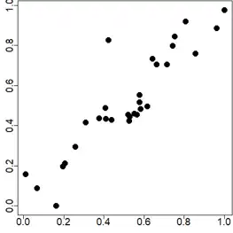
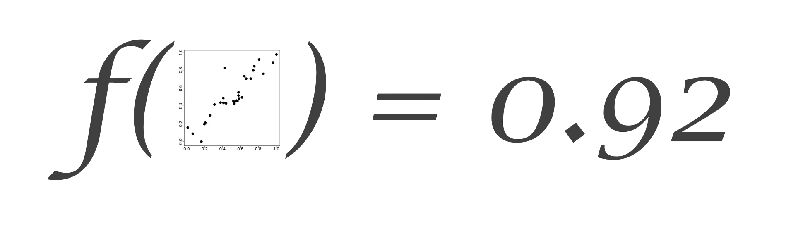

Hellooo community

We launched [a Kaggle competition](https://www.kaggle.com/c/guess-the-correlation/) and now it's time to show you are a DATA SCIENCE Jedi! =D

Link: [https://www.kaggle.com/c/guess-the-correlation/](https://www.kaggle.com/c/guess-the-correlation/)

We did this for sport, please don't try to find any use for this application =P.

## The Game

The [Guess The Correlation](http://guessthecorrelation.com/) website puts a human face to face with a scatterplot and then challenges them to guess its linear correlation. 

Our Kaggle challenge is built the same way. For example: what would you guess is the correlation of the data in the figure below?

<center>

</center>

We generated 200 thousand png images like the one above, and each one has its correlation labeled so we can train a little model.

## Goal

The goal is simple and direct: build a robot that computes the (linear) correlation just by looking at the scatterplot.

In *machine learnese*, we want

<center>

</center>

where this **f** is worthy of being the **f** in **F@!#**.

## Initial guess

[Julião](https://github.com/jtrecenti) has already been working on this problem and took an initial shot at the code for you to get inspired. Well, "initial" is a stretch, because he went straight to a CNN with the help of the [decryptr](https://github.com/decryptr/decryptr) package: 

```{r eval=FALSE}
library(keras)
library(tidyverse)
library(decryptr)

path <- "."
arqs <- dir(paste0(path,  "/train_imgs"), full.names = TRUE)
resp <- readr::read_csv(paste0(path,  "/train_responses.csv"))

i_train <- sample(1:nrow(resp), 10000)
arqs_train <- arqs[i_train]
arqs_test <- arqs[-i_train]

gen <- function(batch_size = 100, arqs = arqs_train) {
  f <- function() {
    a <- sort(sample(arqs, batch_size))
    imgs <- decryptr::read_captcha(a)
    captchas_t <- purrr::transpose(imgs)
    xs <- captchas_t$x
    xs <- abind::abind(xs, along = 0.1)
    a_clean <- a %>% 
      basename() %>% 
      tools::file_path_sans_ext() %>% 
      tolower()
    corr <- resp %>% 
      filter(id %in% a_clean) %>% 
      arrange(id) %>% 
      pull(corr)
    data <- list(xs, corr)
    data
  }
  f
}


# Create model
model <- keras_model_sequential()
model %>%
  layer_conv_2d(
    input_shape = c(150, 150, 1),
    filters = 16, kernel_size = c(3, 3),
    padding = "same",
    activation = "relu") %>%
  layer_max_pooling_2d() %>%
  layer_conv_2d(
    filters = 32, kernel_size = c(3, 3),
    padding = "same",
    activation = "relu") %>%
  layer_max_pooling_2d() %>%
  layer_conv_2d(
    filters = 64, kernel_size = c(3, 3),
    padding = "same",
    activation = "relu") %>%
  layer_max_pooling_2d() %>%
  layer_flatten() %>%
  layer_dense(units = 300) %>%
  layer_dropout(.1) %>%
  layer_dense(units = 1, activation = "tanh")


# Compile and fit model
model %>%
  compile(
    optimizer = "sgd",
    loss = "mean_squared_error",
    metrics = "mean_squared_error")

model %>%
  fit_generator(
    gen(100, arqs_train),
    steps_per_epoch = 100,
    validation_data = gen(100, arqs_test),
    validation_steps = 10
  )
```


So? Can you get it 100% right? Or is it impossible?

Happy R'ing!
