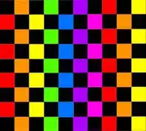

Files with the *.jpg* extension store 5 coordinates, which are
enough for the computer to understand and draw the image:

- `x` and `y`: the cartesian coordinates of the image; and
- `r`, `g` and `b`: red, green and blue, respectively, which together form colors.

Every color we know can be made by combining these
three colors. The intensity of each color ranges from 0 to 1. For each
point on the (x,y) plane there is an associated color. So an image can 
be represented by a dataset with 5 columns (`x`, `y`, 
`r`, `g` and `b`) whose number of rows is the number of pixels in the image.

# Goals

- Find out which model, linear regression or decision trees, is the
most suitable to recover the blue component of the 
[purple_wave.jpg image.](purple_wave.webp)


- Find out which model, linear regression or decision trees, is the
most suitable to recover the blue component of the 
[xadrez_colorido.jpg image.](xadrez_colorido.webp)



# How to start?

With the help of the `readJPEG()` function from the `jpeg` package, load one of the 
images into R and turn it into a data.frame: 

```{r, eval = FALSE}
library(tidyverse)
library(jpeg)
# loads a jpeg image into R
download.file("http://curso-r.comimages/posts/conteudo/desafio-recuperacao-img/purple_wave.webp", 
              destfile = "purple_wave.jpg")

img <- readJPEG("purple_wave.jpg")

# turns the image array into a data.frame with position (x,y)
# and color (r,g,b) info; image dimensions
img_dim <- dim(img)

# RGB to data.frame
img_df <- data.frame(
  x = rep(1:img_dim[2], each = img_dim[1]),
  y = rep(img_dim[1]:1, img_dim[2]),
  r = as.vector(img[,,1]),
  g = as.vector(img[,,2]),
  b = as.vector(img[,,3])
) %>%
  mutate(cor = rgb(r, g, b),
         id = 1:n())

```

```{r eval=TRUE, echo=FALSE, message=FALSE, warning=FALSE}
library(jpeg)
library(tidyverse)
# loads a jpeg image into R

img <- readJPEG("purple_wave.jpg")

# turns the image array into a data.frame with position (x,y)
# and color (r,g,b) info; image dimensions
img_dim <- dim(img)

# RGB to data.frame
img_df <- data.frame(
  x = rep(1:img_dim[2], each = img_dim[1]),
  y = rep(img_dim[1]:1, img_dim[2]),
  r = as.vector(img[,,1]),
  g = as.vector(img[,,2]),
  b = as.vector(img[,,3])
) %>%
  mutate(cor = rgb(r, g, b),
         id = 1:n())

```


Split the data.frame into two parts: one with the blue (column b) and one without.
  - Part 1) `x`, `y`, `r`, `g`
  - Part 2) `x`, `y`, `r`, `g`, `b`

```{r}
# for reproducibility
set.seed(2018) 
# Part 1) x, y, r, g
img_df_parte1 <- img_df %>% 
  sample_frac(3/5) %>% # taking 3/5 of the dataset
  mutate(b_backup = b, # backup of the original blue
         b = 0, # removing the blue from the image
         cor = rgb(r, g, b)) # image color without the blue
# Part 2) x, y, r, g, b
img_df_parte2 <- img_df %>% filter(!id%in%img_df_parte1$id)
```

Visualizing:

```{r}
# Image without the blue
ggplot(data = img_df_parte1, aes(x = x, y = y)) + 
  geom_point(colour = img_df_parte1$cor) +
  labs(x = "x", y = "y", title = "Imagem sem B (azul)") +
  coord_fixed(ratio = 1) +
  theme_bw()
```


Your task is to recover the blue (which we erased from the image) in Part 1, 
using predictive models built with Part 2 (which still has the blue!) for both images (`xadrez_colorido` and `purple_wave`).

# Result

The result of this data challenge will be published on the blog on August 24! Good luck!
