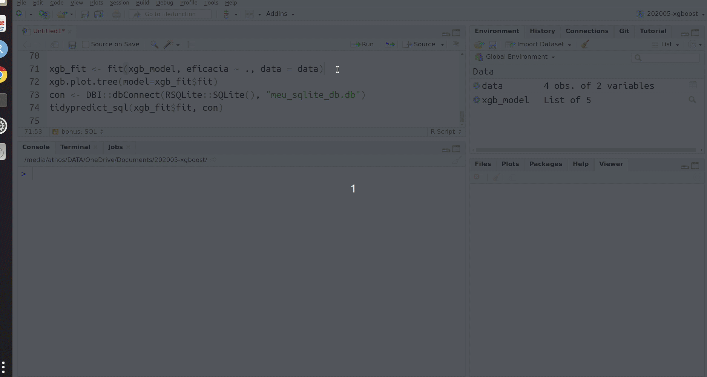

```{r setup, include=FALSE}
knitr::opts_chunk$set(
  echo = TRUE,
  warning = FALSE, 
  message = FALSE, 
  collapse = TRUE
)
```

What you'll learn to do by the end of this post is:



That is, once you have an XGBoost model fitted in your R, you can ask {tidypredict} to generate the SQL query that would compute the score. PS: the XGBoost in the gif has 2 trees. 

### Reasons to use it

If there is a very powerful SQL server (or cluster, etc), the prediction can be done directly inside the database, with no need for other tools. Also, putting it into production will be a CTRL+C/CTRL+V away =P.

### The XGBoost predictor

The value predicted by XGBoost is, deep down, a sum of CASE WHEN's (or IF ELSE's). The number of trees defines how many CASE WHEN's will be added up.

The predictor of an XGBoost with 2 trees would look like this in SQL:


```
<SQL> 0.0 + CASE
WHEN ((`dose` < 5.0 OR ((`dose`) IS NULL))) THEN (-1.95000005)
WHEN (`dose` >= 14.0 AND `dose` >= 5.0) THEN (-1.6500001)
WHEN ((`dose` < 10.0 OR ((`dose`) IS NULL)) AND (`dose` < 14.0 OR ((`dose`) IS NULL)) AND `dose` >= 5.0) THEN (1.05000007)
WHEN (`dose` >= 10.0 AND (`dose` < 14.0 OR ((`dose`) IS NULL)) AND `dose` >= 5.0) THEN (1.35000002)
END + CASE
WHEN ((`dose` < 5.0 OR ((`dose`) IS NULL))) THEN (-1.36500013)
WHEN (`dose` >= 14.0 AND `dose` >= 5.0) THEN (-1.15499997)
WHEN ((`dose` < 10.0 OR ((`dose`) IS NULL)) AND (`dose` < 14.0 OR ((`dose`) IS NULL)) AND `dose` >= 5.0) THEN (0.734999955)
WHEN (`dose` >= 10.0 AND (`dose` < 14.0 OR ((`dose`) IS NULL)) AND `dose` >= 5.0) THEN (0.945000052)
END + 0.5
```

### Minimal code

The true hero of the code below is the line `tidypredict_sql(xgb_fit$fit, con)` from the [`{tidypredict}`](https://tidypredict.tidymodels.org/) package, which takes the fitted XGBoost object and returns the SQL query with the CASE WHEN's.

#### Fitting the XGBoost with {tidymodels}

```{r}
library(tidymodels)
library(tidypredict)
library(xgboost)

# data -----------------------------------------------------
data <- tibble(
  dose = c(2, 8, 12, 18),
  eficacia = c(-6, 4, 5, -5)
)

# model specification -------------------------------------
xgb_model <- boost_tree(min_n = 1, 
  trees = 2
) %>%
  set_engine("xgboost", lambda = 0) %>%
  set_mode("regression")

# model fit ----------------------------------------------
xgb_fit <- fit(xgb_model, eficacia ~ dose, data = data)

# Connection to the SQL database --------------------------
con <- DBI::dbConnect(RSQLite::SQLite(), "meu_sqlite_db.db")

# Transcribing XGBoost to SQL -----------------------------
tidypredict_sql(xgb_fit$fit, con)
```

#### Using {dplyr} to run code in SQL

```{r}
# just uploading the data to the SQL database --------
copy_to(con, data, "data", overwrite = TRUE)

# Creating the `pred` column with the SQL predictions
data_sql <- tbl(con, "data") %>%
  mutate(
    pred = !!tidypredict_sql(xgb_fit$fit, con)
  )

# result ----------------------------------------------
data_sql
```

PS: the `tidypredict_sql()` function returns a string, so we use the `!!` operator to interpret it as literal R code. This part can be confusing because dplyr will take the code and turn it into the literal, but it **won't** run the code in R, it will translate from R to SQL directly (and that's why it works, because the string isn't valid R code =P).

####  SQL behind the scenes

The `data_sql` table generated above by {dplyr} is actually an SQL query. The `show_query()` function shows the resulting translation:

```{r}
show_query(data_sql)
```

## Summary

- XGBoost to SQL is as simple as one line of code: `tidypredict_sql(xgb_fit$fit, con)`
- The SQL query can be used inside `mutate()` with `!!`
- XGBoost predictions are no rocket science, they are simple sums of CASE WHEN's.

### Appendix: the two trees

```{r}
library(DiagrammeR)
xgb.plot.tree(model=xgb_fit$fit)
```

```{r, include=FALSE}
cat(getwd())
DBI::dbDisconnect(con)
file.remove("meu_sqlite_db.db")
```

