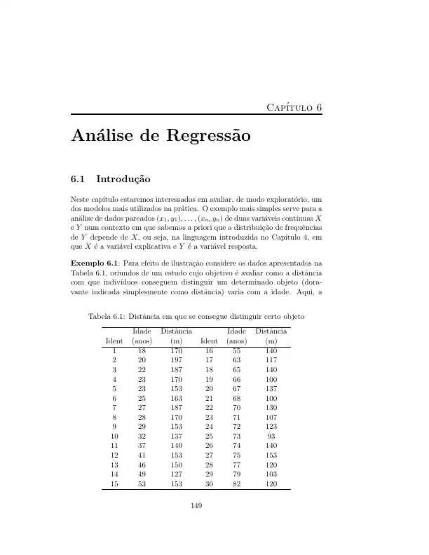

```{r, include=FALSE}
knitr::opts_chunk$set(
  echo = TRUE,
  warning = FALSE, 
  message = FALSE, 
  collapse = TRUE
)
```


## Summary

> `tabulizer::extract_tables("caminho/do/arquivo.pdf", pages = 153)`

That's all!! I decided to write this post because I was happy with how easy it was to bring a table from a PDF into R after CTLR+C/CTRL+V failed miserably.

A potential obstacle may be the infamous {rJava}, which {tabulizer} depends on. But on **linux** I ran `sudo apt install default-jdk default-jre` and it worked for me! I haven't tested it on **windows**, but there's [this tutorial here](https://mauriciogeneroso.medium.com/configurando-java-1-instala%C3%A7%C3%A3o-do-jre-e-do-jdk-no-windows-38cacace0377) (in Portuguese).

## Task

Extract a table from a page of a pdf file. `url_pdf` holds the address of a PDF on the internet.

```{r}
url_pdf <- "https://curso-r.github.io/main-regressao-linear/referencias/Ci%C3%AAncia%20de%20Dados.%20Fundamentos%20e%20Aplica%C3%A7%C3%B5es.%20Vers%C3%A3o%20parcial%20preliminar.%20maio%20Pedro%20A.%20Morettin%20Julio%20M.%20Singer.pdf"
```

## A look at the PDF page

```{r}
# takes a screenshot of page 153 and saves it as a PNG image.
pdftools::pdf_convert(url_pdf, pages = 153, filenames = "pag153.png")
```

```{r}
# shows the PNG image.

```

## Extracting the table PDF -> R

```{r}
# extracts the table from the PDF (not from the PNG!)
tabela_extrida_do_pdf <- tabulizer::extract_tables(url_pdf, pages = 153)
tabela_extrida_do_pdf[[1]]
```

QED! `r "\u2b1b"`

## Bonus: Cleaning up the table

Once it's inside R, it's game on. Let's clean it up, which is what we do best. The challenge is to stack the columns in groups of 3, `Ident, (anos), (m)`. We have two individuals per row, and we need to stack them so that in the end we have one row per individual, by the book. The hero here is `pivot_longer()`.


```{r}
library(tidyverse)
library(janitor)

tabela_extrida_do_pdf[[1]] %>%
  as_tibble(.name_repair = "unique") %>%
  row_to_names(2) %>%
  clean_names() %>%
  pivot_longer(everything(), names_to = c(".value", "conjunto"), names_sep = "_") %>%
  select(-conjunto) %>%
  head() %>%
  kableExtra::kable()
```


## Related reading

I suggest reading the post [PDF e OCR](https://www.curso-r.com/blog/2017-05-27-ocr/) (in Portuguese) by [Julio Trecenti]() for more advanced features of {pdftools}, {tesseract} and {tabulizer}.

## Random comment

Take the chance to check out the 2020 book [**Ciência de dados: Fundamentos e Prática**](https://docplayer.com.br/156868089-Ciencia-de-dados-fundamentos-e-aplicacoes-versao-parcial-preliminar-maio-pedro-a-morettin-julio-m-singer.html) (in Portuguese) by Professors Julio Singer and Renato Morettin.

Thanks!

```{r, include=FALSE}
file.remove("pag153.png")
```

