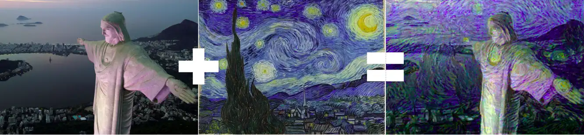
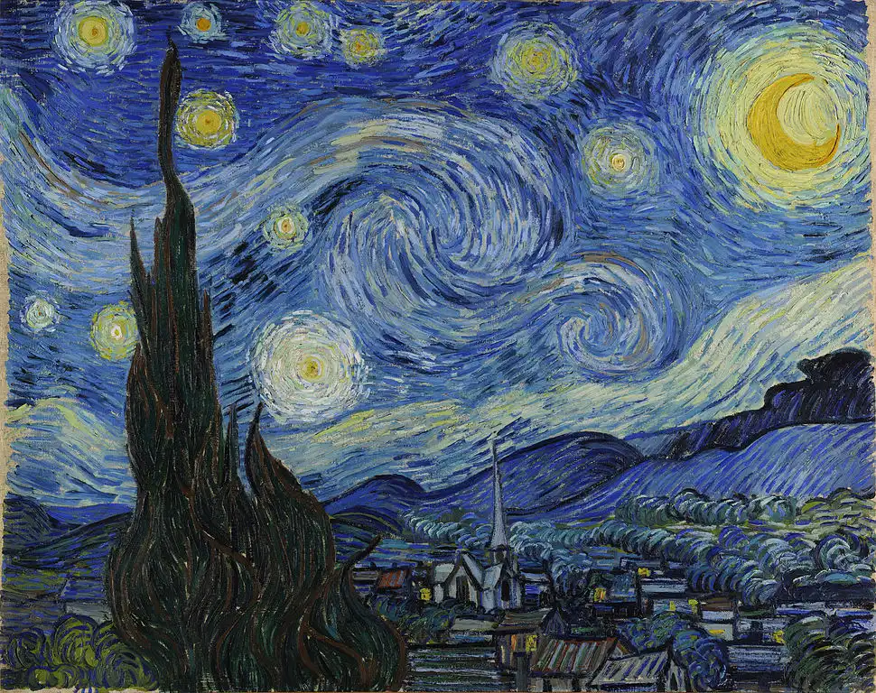
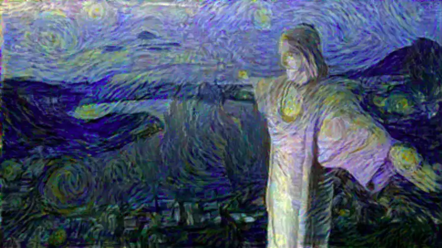

```{r, include=FALSE}
knitr::opts_chunk$set(
  echo = TRUE,
  warning = FALSE,
  message = FALSE,
  collapse = TRUE,
  eval = FALSE
)
```

```{r}
library(torch)
library(torchvision)
library(zeallot)
device <- torch_device(if(cuda_is_available()) "cuda" else "cpu")
cpu <- torch_device("cpu")
```

Neural Style Transfer is one of the most fun and "artistic" techniques in deep learning. The image below sums up what we are going to do.



You give the neural network two images, `style` and `content`, and the result is the `content` image in the style of `style`. It's like an Instagram filter, but with the style of your favorite artist =P.

This post adapts to R + torch an exercise from the [deeplearning.ai 'Convolutional Neural Networks' course](https://www.coursera.org/learn/convolutional-neural-networks/) that I took, originally in Python + tensorflow. When I started writing this post, I meant to make it as didactic as possible, but I don't think I could beat the Coursera course, so I'll stick to the main points and comment the code for anyone who wants to create their own images! Also, [this video (in Portuguese) gives a summary of the NST strategy.](https://www.youtube.com/watch?v=iAyL5iCWWAs)

PS: while writing this post I found out that Daniel had already written [a little NST example for torchvision.](https://torchvision.mlverse.org/articles/examples/style-transfer.html) I stole part of the code from there haha.


## Key concepts and ideas

The idea is to generate a `generated` image G whose content is similar to `content` C and whose style is similar to `style` S. Content and style are usually extracted from a pre-trained convnet. The original paper [@gatys2015neural] uses VGG19, which already comes with {torchvision}.

```{r}
# VGG19 model
vgg <- model_vgg19(pretrained = TRUE)$features$to(device = device)

# freezing the weights
vgg$parameters %>% purrr::walk(function(param) param$requires_grad_(FALSE))
```

So VGG19 will give us the features, and now we need to define cost functions to find the image with the best trade-off between the content of one image and the style of another. Building the algorithm can be split into three parts:

- `content` cost function: $L_{content}(C, G)$
- `style` cost function: $L_{style}(S, G)$
- Overall cost function: $L(G) = \alpha L_{content}(C, G) + \beta L_{style}(S, G)$

### `content` cost function

On choosing shallow versus deep layers:

- The first layers of a convolutional network tend to extract more basic patterns, such as edges and simple textures.
- Deeper layers usually capture more sophisticated features, such as detailed textures and objects.

As for picking a middle layer: we want the `generated` image to have content similar to `content`. The strategy is:

1) choose one layer of the network to represent this "content".
2) take that layer for each of the `content` and `generated` images.
3) make the network force these two layers to be as similar as possible.

So the cost function that reflects point (3) can simply be the mean squared error between the pixels of that layer:

```{r}
content_loss <- function(content_layer, generated_layer) {
  nnf_mse_loss(content_layer, generated_layer)
}
```

NOTE: In practice, you'll get the "coolest" result if you **choose layers from the middle**: not too shallow, not too deep. Since VGG19 has 37 layers, the chosen one could be, for example, layer 14.

### `style` cost function

The purpose of the `style` cost function is to minimize the distance between the so-called *Gram matrices* of the `style` and `generated` images.

#### Gram matrix

In the literature, the style matrix is called the *Gram matrix*. In mathematics, given a set of vectors, the *Gram matrix* is the matrix of the inner products of every pair of those vectors. It's like a correlation matrix, but without centering by the mean. In practice, you take a layer of the network, reshape it into a 2D tensor (a matrix) and compute $A * A^T$.

```{r}
gram_matrix <- function(tensor) {
  c(b,c,h,w) %<-% tensor$size()
  tensor <- tensor$view(c(c, h*w))
  torch_matmul(tensor, tensor$t())/(h*w)
}
```

The cost function $L_{style}(S, G)$ is the good old mean squared error between the *Gram matrices*.

```{r}
style_loss <- function(style_layer, generated_layer) {
  style_gram <- gram_matrix(style_layer)
  generated_gram <- gram_matrix(generated_layer)
  nnf_mse_loss(style_gram, generated_gram)
}
```

#### Style layers

Instead of one, we take five intermediate layers of the network and compute the distances between their *Gram matrices*. The cost function then becomes a weighted sum of these five distances: $L_{style}(S, G) = \sum_{l=1}^{5}\lambda^{[l]}L_{style}^{[l]}(S,G)$

```{r}
style_layers <- c(2, 7, 12, 21, 29) # choice of VGG layers
lambdas <- 1e5/(c(1,10,10,10,10)^2) # weights for each layer in the final style
```

Now it's worth creating an nn_module() that returns the intermediate layers of the network (VGG19, in this case). The `layers_out` argument lets us choose which layers we want back.

```{r}
features <- nn_module(
  initialize = function(convnet) {
    # could be any pre-trained convnet. We'll use VGG19
    self$convnet <- convnet
  },
  forward = function(img, layers_out = NULL) {
    layers <- seq_along(self$convnet) # 1 to 37
    if(is.null(layers_out)) layers_out <- layers
    conv_outs <- purrr::accumulate(layers, ~self$convnet[[.y]](.x), .init = img) # list of 37 tensors
    conv_outs[layers_out] # list with only the selected layers
  }
)
```


## Optimization

Below is the commented code to run the optimization.

```{r}
# helper functions
to_r <- function(x) as.numeric(x$to(device = cpu))

plot_image <- function(tensor) {
  im <- tensor$to(device = "cpu")[1,..]$
    permute(c(2, 3, 1))$
    to(device = "cpu")$
    clamp(0,1) %>% # make it [0,1]
    as.array()
  par(mar = c(0,0,0,0))
  plot(as.raster(im))
}

load_image <- function(path, geometry = "250x200") {
  img <- path %>%
    magick_loader() %>%
    magick::image_resize(geometry) %>%
    transform_to_tensor() %>%
    torch_unsqueeze(1)

  img$to(device = device)
}
```

The parameters and inputs worth experimenting with are:

- `content` and `style`: the input images, one for content and one for style.
- `content_layer`: the VGG19 layer used to extract the content of the content image.
- `style_layers`: the VGG19 layers used to extract the style of the style image.
- `lambdas`: the weight of each style feature in the optimization.
- `content_weight`: the weight of the content features in the optimization.
- `style_weight`: the (overall) weight of the style features in the optimization.

Two other parameters that drastically affect the result are the dimensions of the two input images. In the code below, `"400x400"` and `"350x500"` can be swapped for other dimensions to get different results.

While creating, you'll be tweaking these parameters all the time!

```{r}
# INPUT: content and style images
content <- load_image("content/posts/2021-02-22-neural-style-transfer/cristoredentor3.jpg", "400x400")
style <- load_image("content/posts/2021-02-22-neural-style-transfer/vangogh_starry_night.jpg", "350x500")

# style and content feature setup
content_layer <- 14
style_layers <- c(2, 7, 12, 21, 29)
lambdas <- 1e5/(c(1,10,10,10,10)^2)
content_weight <- 2
style_weight <- 4e-1
```




```{r}
# FEATURES: extracted from VGG19
vgg_features <- features(vgg)
content_features <- vgg_features(content, content_layer)
style_features <- vgg_features(style, style_layers)

# OUTPUT: generated image
generated <- torch_clone(content)$requires_grad_(TRUE)
optim <- optim_adam(generated, lr = 0.02)
lr_scheduler <- lr_step(optim, 100, 0.9)

# optimization loop
for(step in seq_len(8000)) {
  optim$zero_grad()
  # update the features of the image being generated
  generated_features <- vgg_features(generated, c(content_layer, style_layers))

  # losses
  LC <- content_loss(content_features[[1]], generated_features[[1]])
  LS <- 0
  for(i in seq_along(lambdas))
    LS <- LS + lambdas[i]*style_loss(style_features[[i]], generated_features[-1][[i]])

  loss <- content_weight * LC + style_weight * LS

  loss$backward()
  optim$step()
  lr_scheduler$step()

  # feedback
  if(step %% 100 == 0) {
    cat(glue::glue("LC = {to_r(LC)} - LS = {to_r(LS)} - Loss = {to_r(loss)}\n\n"))
    plot_image(generated)
  }
}

# final image
plot_image(generated)
```

    LC = 2.70741701126099 - LS = 36.7998428344727 - Loss = 20.1347713470459
    LC = 2.61282753944397 - LS = 24.3190288543701 - Loss = 14.9532661437988
    LC = 2.54735898971558 - LS = 19.7909469604492 - Loss = 13.0110969543457
    LC = 2.49572896957397 - LS = 16.9353790283203 - Loss = 11.7656097412109
    LC = 2.44669985771179 - LS = 16.6177845001221 - Loss = 11.5405139923096




So, does it look like a painting? Tell us what you think! Try it with your own images and share them with us =). Learning how NST works is a great exercise for improving your understanding of deep learning models in general, especially how we can design cost functions specialized for a given context.

## Learn Deep Learning with Curso-R

If you want to get into the amazing world of deep networks, our [Deep Learning](https://www.curso-r.com/cursos/deep-learning/) course is the best way in. Check it out!
