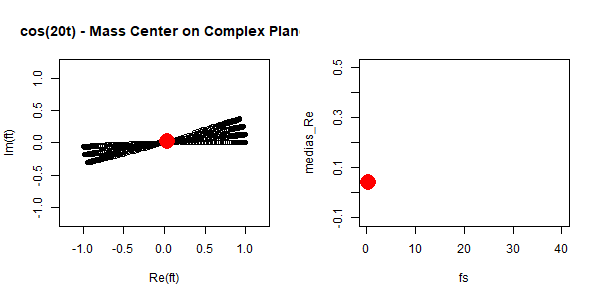

```{r setup, include=FALSE}
knitr::opts_chunk$set(echo = TRUE, message = FALSE, warning = FALSE, collapse = TRUE)
```

A while ago I [posted on LinkedIn](https://www.linkedin.com/posts/athosdamiani_rstats-rstats-python-share-6961686612699168768-cPvc/) an #rstats GIF inspired by 3Blue1Brown's [But what is the Fourier Transform? A visual introduction](https://www.youtube.com/watch?v=spUNpyF58BY). This post is that GIF, with the [code](https://gist.github.com/Athospd/e554e9090564984a527bb81db1728b0c) behind it.



## The idea

Take a signal $g(t)$, here $g(t) = \cos(20t)$ for $t$ between 0 and 1, and wrap it around the origin of the complex plane. Each point of the signal becomes $g(t)\,e^{i\omega t}$: the angle comes from $t$ and the winding frequency $\omega$, and the distance from the origin comes from $g(t)$.

Then take the centre of mass of the wrapped curve, the average of all its points:

$$
\hat{g}(\omega) = \frac{1}{T}\int_0^T g(t)\,e^{i\omega t}\,dt
$$

- **left panel**: the wrapped curve for the current $\omega$ and its centre of mass (red dot).
- **right panel**: the real part of the centre of mass as $\omega$ goes from 0.4 to 40.

For most winding frequencies the curve spreads evenly around the origin and the centre of mass stays near 0. When $\omega = 20$, the frequency of the cosine, the peaks of the signal all land on the same side of the circle and the centre of mass jumps to about 0.5. That spike is the frequency showing up in the Fourier transform.

## The code

`f()` is the signal and `expi()` is $e^{ix}$ written as $\cos x + i \sin x$. For each `a`, `x` runs from 0 to `a * L` and the signal is evaluated at `x / (a * L)`, which goes from 0 to 1. So `expi(x) * f(x / (a * L))` is $g(t)\,e^{i\omega t}$ with $\omega = a L$.

```{r}
f <- function(x) cos(x*20)
expi <- function(x) cos(x) + sin(x)*1i
L <- 40
medias_Re <- c()
fs <- c()
as <- seq(0.01, 1, l = 140)
```

The original gist writes the GIF with `animation::saveGIF()`, which needs ImageMagick, and pauses with `Sys.sleep(0.1)` between frames. Here `gifski::save_gif()` records each plot as a frame instead, so `par(mfrow = c(1,2))` moves inside the block to apply to the GIF's device.

```{r, results='hide'}
gifski::save_gif({
  par(mfrow = c(1,2))
  for(a in as) {
    x <- seq(0, a*40, l = 500)
    ft <- expi(x)*f(x/(a*L))
    media_Re <- mean(Re(ft))
    plot(Re(ft), Im(ft), xlim = c(-1.2, 1.2), ylim = c(-1.2, 1.2), main = "cos(20t) - Mass Center on Complex Plane")
    points(media_Re, mean(Im(ft)), col = "red", cex = 3, pch = 16 )
    medias_Re <- c(medias_Re, media_Re)
    fs <- c(fs, a*L)
    plot(fs, medias_Re, type = "l", xlim = c(0, 40), ylim = c(-0.11, 0.51))
    points(a*L, media_Re, col = "red", cex = 3, pch = 16)
  }
}, gif_file = "fourier.gif", width = 600, height = 300, delay = 0.1)
```

```{r, include=FALSE}
# listing thumbnail: the wrapped curve at the peak (omega = 20) next to the full curve
a <- 20 / L
x <- seq(0, a*40, l = 500)
ft <- expi(x)*f(x/(a*L))
png("fourier.png", width = 600, height = 300)
par(mfrow = c(1,2))
plot(Re(ft), Im(ft), xlim = c(-1.2, 1.2), ylim = c(-1.2, 1.2), main = "cos(20t) - Mass Center on Complex Plane")
points(mean(Re(ft)), mean(Im(ft)), col = "red", cex = 3, pch = 16)
plot(fs, medias_Re, type = "l", xlim = c(0, 40), ylim = c(-0.11, 0.51))
points(20, mean(Re(ft)), col = "red", cex = 3, pch = 16)
dev.off()
```

The video goes further, from this centre-of-mass picture to the Fourier transform formula itself.
