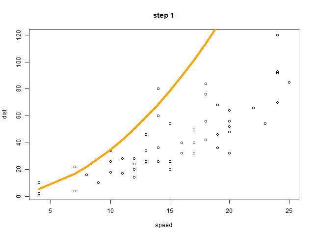

```{r setup, include=FALSE}
knitr::opts_chunk$set(echo = TRUE, message = FALSE, warning = FALSE, collapse = TRUE)
```

I found an old [gist](https://gist.github.com/Athospd/97f16d5768ef72e87d2840f524597653) on my GitHub about the learning rate. It fits a regression line by gradient descent, and it's oddly satisfying to watch. A bit insightful too.



There are three curves, one for each learning rate:

- **orange**: too low (`lr = 0.001`). Each step is tiny, so after 100 steps the curve is still far from the points.
- **red**: too high (`lr = 2`). Each step overshoots, so the curve swings far from the points before it settles.
- **blue**: just right (`lr = 0.05`). The curve moves steadily toward the points and stays there.

## The learning rate

Gradient descent updates the model parameters a little at each step, in the direction that lowers the loss:

$$\theta_{t+1} = \theta_t - \eta \, \nabla L(\theta_t)$$

The learning rate $\eta$ is the size of that step. The optimizer below is Adam, which adapts the step for each parameter, but the learning rate still sets its scale.

## The code

The data is the `cars` dataset: stopping distance (`dist`) as a function of speed. The model is `dist ~ speed + speed^2`, written as a linear layer with two inputs.

```{r}
library(torch)
torch_manual_seed(1)

x <- torch_tensor(cbind(cars$speed, cars$speed^2))
y <- torch_tensor(cars$dist)$unsqueeze(2)
mse <- nn_mse_loss()

model_gen <- function(lr) {
  lin <- nn_linear(2, 1)  # b0, b1 and b2
  opt <- torch::optim_adam(lin$parameters, lr = lr)
  return(list(lin = lin, opt = opt))
}

model_fit <- function(model) {
  model$opt$zero_grad()

  pred <- model$lin(x) # b0 + b1*speed + b2*speed^2
  custo <- mse(y, pred)
  custo$backward()
  model$opt$step()
  return(pred)
}
```

Three copies of the same model, one per learning rate:

```{r}
model1 <- model_gen(2)
model2 <- model_gen(0.05)
model3 <- model_gen(0.001)
```

Each iteration takes one optimizer step for each model and draws the three fitted curves. The original gist plots to the screen with `Sys.sleep(0.1)` between steps. Here `gifski::save_gif()` records each plot as a frame instead.

```{r, results='hide'}
gifski::save_gif({
  for (i in 1:100) {
    pred1 <- model_fit(model1)
    pred2 <- model_fit(model2)
    pred3 <- model_fit(model3)
    plot(cars, main = paste("step", i))
    lines(x[, 1]$unsqueeze(2), pred1, col = "red", lwd = 4)
    lines(x[, 1]$unsqueeze(2), pred2, col = "royalblue", lwd = 4)
    lines(x[, 1]$unsqueeze(2), pred3, col = "orange", lwd = 4)
  }
}, gif_file = "learning_rate.gif", width = 640, height = 480, delay = 0.1)
```

```{r, include=FALSE}
# listing thumbnail: the last frame
png("learning_rate.png", width = 640, height = 480)
plot(cars, main = "step 100")
lines(x[, 1]$unsqueeze(2), pred1, col = "red", lwd = 4)
lines(x[, 1]$unsqueeze(2), pred2, col = "royalblue", lwd = 4)
lines(x[, 1]$unsqueeze(2), pred3, col = "orange", lwd = 4)
dev.off()
```

Tune your models, folks!
