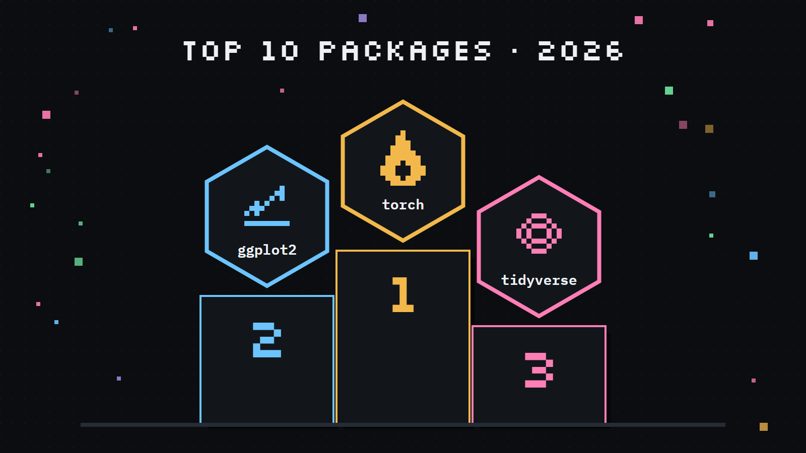

```{r setup, include=FALSE}
knitr::opts_chunk$set(echo = TRUE, message = FALSE, warning = FALSE, error = FALSE, collapse = TRUE)
```

In 2017 I wrote my [top 10 packages for data science](../2017-02-21-top10-pacotes-para-data-science/). Nine years later, some of them are still on my list, some were replaced by their successors, and some new ones changed the way I work. Here is the 2026 edition, plus a special mention for the packages of the GenAI era.



### [10. purrr](https://purrr.tidyverse.org/) (vector and list manipulation)

Still here, and still putting the `for` loop at risk of extinction. `map()` and friends apply functions over vectors and lists without i, j, k indices, and they are the natural way to work with *list-columns*. Since version 1.1, `in_parallel()` runs the same `map()` calls in parallel, too.

### [9. tidymodels](https://www.tidymodels.org/) (statistical modeling)

*Replaces caret.* It was made by caret's own author, Max Kuhn, as its successor. The pieces of the modeling process are separate packages that fit together: {rsample} for train/test splits and cross-validation, {recipes} for preprocessing, {parsnip} for one interface to many engines (glmnet, ranger, xgboost, lightgbm...), {tune} for hyperparameter tuning, and {yardstick} for metrics. Most posts on this blog with a model in them use it, like the [untuned vs tuned xgboost](../2026-11-20-xgboost-untuned-vs-tuned/) one.

### [8. Quarto](https://quarto.org/) (reports)

*Replaces knitr/rmarkdown.* Quarto is RMarkdown's successor, from the same team. Same idea, write the analysis and let the tool make the pdf, word or html, but it works with R, Python and Julia alike, and it does websites, books, slides and dashboards out of the box. knitr is still under the hood when the code is R.

PS: this blog is made with Quarto!

### [7. mirai](https://mirai.r-lib.org/) (async and parallel computing)

*Replaces stringr.* {mirai} evaluates R code asynchronously and in parallel, on your laptop or spread across the machines of a cluster. It's now an official cluster type in R's own {parallel} package. Its best trick is that you rarely call it directly: it is the engine behind a lot of the R you already use.

- {purrr}: `map(x, in_parallel(f))` runs a `map()` in parallel.
- {shiny}: long computations run in the background (`ExtendedTask`) while the app stays responsive.
- {targets}: through {crew}, the steps of a pipeline run on parallel workers, locally or in the cloud.
- {promises}: any async R code can wait on a mirai.

Parallel R used to mean choosing between a handful of frameworks with different rules. Now it's mostly one engine, and it's fast.

### [6. lubridate](https://lubridate.tidyverse.org/) (date manipulation)

Dates are still an endless source of headaches, and lubridate is still the cure: parsing, arithmetic, comparisons, rounding, time zones.

### [5. shiny](https://shiny.posit.co/) (web apps)

Web applications without html, css or javascript. Shiny is more mature than ever, with modern themes from {bslib}, and it now exists for Python too.

### [4. targets](https://docs.ropensci.org/targets/) (pipelines)

*New on the list.* {targets} turns an analysis into a pipeline of steps that know their dependencies. Change one step and only what depends on it runs again; everything else is skipped. For projects with a long data preparation or slow models, it's the difference between waiting hours and waiting seconds, and the results are reproducible by design.

### [3. tidyverse](https://www.tidyverse.org/) (data manipulation)

*Replaces dplyr (3rd) and tidyr (4th).* In 2017 they were two separate medals. Today `library(tidyverse)` loads them together with ggplot2, readr, tibble, purrr, stringr, forcats and lubridate, and that's how most people use them. dplyr's verbs (`filter()`, `arrange()`, `select()`, `distinct()`, `mutate()`, `summarise()`) are the same, now with `.by` for grouping in one line, and tidyr's `gather()`/`spread()` became `pivot_longer()`/`pivot_wider()`.

### [2. ggplot2](https://ggplot2.tidyverse.org/) (visualization)

Still the silver medal and still the most famous R package. The [grammar of graphics](https://vita.had.co.nz/papers/layered-grammar.pdf) is as useful as ever, and the ecosystem around it ({patchwork}, {gganimate}, {ggiraph} and many more) keeps growing. A must in any data scientist's toolbox.

### [1. torch](https://torch.mlverse.org/) (deep learning)

*Replaces magrittr.* The pipe was my gold medal in 2017. It won so completely that base R has had its own pipe, `|>`, since R 4.1, so magrittr retires from the list with honors.

The gold medal now goes to {torch}: deep learning in R, built directly on the C++ library behind PyTorch (LibTorch), without Python. Tensors on the GPU, automatic differentiation and neural network modules, with an R interface. Automatic differentiation alone makes it worth learning: any model you can write as a function, you can fit with gradient descent. A few posts on this blog use it, like [simple audio classification](../2021-02-04-simple-audio-classification-with-torch/) and the [learning rate](../2026-11-20-learning-rate/) one.

### Honorable mentions

- **keras3** (deep learning with a high-level API)
- **torchvision** (images, datasets and pretrained models for torch)
- **forcats** (factor utilities)
- **Rcpp** (R to C++)
- **FactoMineR** (multivariate analysis)
- **DBI** (database connection)
- **httr2/xml2/rvest** (web tools)
- **janitor** (data cleaning for modeling)
- **roxygen2** (R package creation)
- **devtools/usethis** (package development tools)
- **htmlwidgets** (integration between R and JavaScript libraries)
- **leaflet** (interactive maps)

### Special mention: the GenAI era

LLMs, RAG and agents arrived in R too, and a new family of packages came with them:

- [**ellmer**](https://ellmer.tidyverse.org/): chat with LLMs from many providers (Claude, OpenAI, Gemini, local models via Ollama and more), with streaming, tool calling and structured data extraction.
- [**ragnar**](https://ragnar.tidyverse.org/): Retrieval-Augmented Generation (RAG) workflows. Reads documents, splits them into chunks, generates embeddings, stores them and retrieves the relevant ones for the LLM.
- [**mcptools**](https://posit-dev.github.io/mcptools/): the Model Context Protocol (MCP) for R. Serve R functions as tools for apps like Claude Desktop and Claude Code, or use other MCP servers' tools from R.
- [**btw**](https://posit-dev.github.io/btw/): describes your R objects, workspace and package documentation in a format LLMs understand.
- [**vitals**](https://vitals.tidyverse.org/): evaluates LLM-based products, an R port of Python's Inspect framework.
- [**shinychat**](https://posit-dev.github.io/shinychat/) and [**querychat**](https://posit-dev.github.io/querychat/): a chat interface for Shiny apps, and a chat that turns users' questions into SQL queries over your data.

I'm still discovering and learning this whole new world. But it's as sure as the sunrise that it's here to stay.

## What the downloads say

A top 10 is a matter of taste, but the download counts are data. The CRAN logs of Posit's mirror are public, so here are the 2017 list and the 2026 list, with downloads in the month before each post.

```{r}
library(tidyverse)
options(knitr.kable.NA = "")

downloads <- function(pkgs, from, to) {
  url <- str_glue("https://cranlogs.r-pkg.org/downloads/total/{from}:{to}/{str_flatten(pkgs, ',')}")
  jsonlite::fromJSON(url) |> select(package, downloads)
}

top_2017 <- c("magrittr", "ggplot2", "dplyr", "tidyr", "shiny", "lubridate", "stringr", "rmarkdown", "caret", "purrr")
top_2026 <- c("torch", "ggplot2", "tidyverse", "targets", "shiny", "lubridate", "mirai", "quarto", "tidymodels", "purrr")

pkgs <- union(top_2017, top_2026)

bind_rows(
  feb_2017 = downloads(pkgs, "2017-01-21", "2017-02-20"),
  nov_2026 = downloads(pkgs, "2026-10-20", "2026-11-18"),
  .id = "month"
) |>
  pivot_wider(names_from = month, values_from = downloads) |>
  mutate(
    feb_2017 = na_if(feb_2017, 0), # torch, targets, tidymodels, quarto and mirai didn't exist yet
    rank_2017 = match(package, top_2017),
    rank_2026 = match(package, top_2026)
  ) |>
  arrange(rank_2026, rank_2017) |>
  knitr::kable(format.args = list(big.mark = ","))
```

A few things stand out:

- ggplot2 is the most downloaded package on CRAN that you'd install on purpose. Only rlang, a low-level dependency of almost everything, beats it.
- magrittr still has more than 1.6 million downloads a month, mostly as a dependency of other packages, even with the native pipe in base R.
- torch, mirai and targets are far from the top in downloads. They're on my list because of what they do for my work, not because everyone uses them (yet).
- Quarto is a command-line tool, not an R package. The `quarto` R package only calls it, so its downloads say little about how many people use Quarto.

These numbers only count Posit's CRAN mirror, so they are a sample, not the whole picture.

What about you, do you agree? Tell me which packages live in your heart! =)
