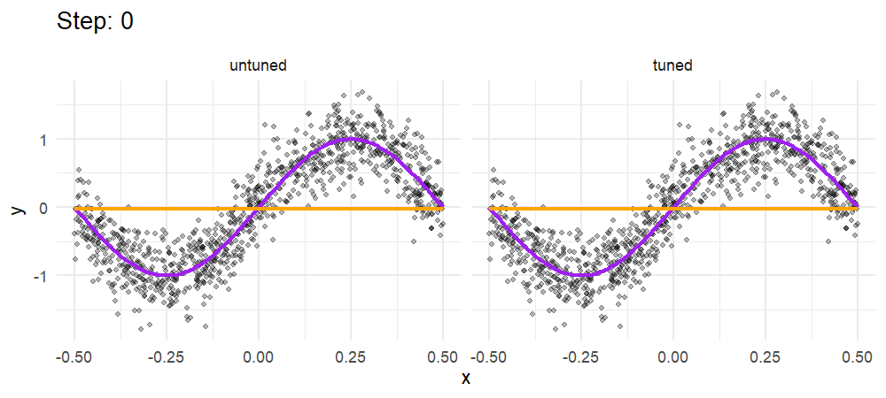

```{r setup, include=FALSE}
knitr::opts_chunk$set(echo = TRUE, message = FALSE, warning = FALSE, collapse = TRUE)
```

A while ago I [posted on LinkedIn](https://www.linkedin.com/posts/athosdamiani_rstats-python-datascience-share-6963297319974785024-xrKM/) an "untuned vs tuned xgboost fit" GIF. This post rebuilds it from the [original code](https://gist.github.com/Athospd/1295babba90315b4e5002262c24b08a0), with both models side by side.



- **points**: 1,000 noisy observations of a sine curve.
- **purple**: the true curve, $\sin(2\pi x)$.
- **orange**: the model's prediction after each boosting round. Each round adds one tree, and each tree adds a few steps to the curve.

Both panels use the same data and the same algorithm. Only the hyperparameters differ. With the defaults, the curve takes big steps early on and then starts chasing the noise. With tuned hyperparameters, it moves to the sine in smaller steps and stays smooth.

## The data

```{r}
library(tidyverse)
library(tidymodels)
library(gganimate)
theme_set(theme_minimal(16))

set.seed(1)
dados <- tibble(
  x = runif(1000) - 0.5,
  y = sin(x * pi * 2) + rnorm(1000, sd = 0.3)
)
```

The noise has standard deviation 0.3, so no model can get a root mean squared error (RMSE) below about 0.3 on new data.

## Two models

The tuned model uses the hyperparameters from the gist. The untuned one keeps `boost_tree()`'s defaults: 15 trees, `tree_depth = 6` and `learn_rate = 0.3`. Both start from the same `base_score`, the mean of `y`.

```{r}
trees <- 30

tuned <- boost_tree(
  mode = "regression",
  mtry = 1,
  trees = trees,
  min_n = 1,
  tree_depth = 4,
  learn_rate = 0.1,
  sample_size = 1,
  loss_reduction = 0.1
) %>%
  set_engine("xgboost", base_score = mean(dados$y))

untuned <- boost_tree(mode = "regression") %>%
  set_engine("xgboost", base_score = mean(dados$y))

ajustes <- list(
  untuned = fit(untuned, y ~ x, data = dados),
  tuned   = fit(tuned, y ~ x, data = dados)
)
```

## One prediction per boosting round

`ntreelimit` tells xgboost to predict with only the first `step` trees. The gist called it with `step - 1`, but `ntreelimit = 0` means "all trees", so its first frame showed the final fit. Here step 0 is the starting point, the `base_score`, and steps past the last tree (the untuned model has 15) keep the full model.

```{r}
dados_xgb <- dados %>% select(x) %>% as.matrix()

predict_xgb <- function(ajuste, step) {
  pred <- if (step == 0) {
    rep(mean(dados$y), nrow(dados))
  } else {
    xgboost:::predict.xgb.Booster(ajuste$fit, newdata = dados_xgb, ntreelimit = min(step, ajuste$fit$niter))
  }
  dados %>% mutate(pred = pred)
}

df <- expand_grid(modelo = names(ajustes), step = 0:trees) %>%
  mutate(preds = map2(modelo, step, ~ predict_xgb(ajustes[[.x]], .y))) %>%
  unnest(preds) %>%
  mutate(modelo = factor(modelo, levels = names(ajustes)))
```

## The GIF

Same plot as the gist, with one panel per model.

```{r}
gif <- df %>%
  ggplot(aes(x = x)) +
  geom_point(aes(y = y), size = 1.5, alpha = 0.3) +
  stat_function(fun = ~sin(. * pi * 2), colour = "purple", linewidth = 1.5) +
  geom_step(aes(y = pred), colour = "orange", linewidth = 1.5) +
  facet_wrap(~ modelo) +
  transition_time(step) +
  labs(title = 'Step: {frame_time}') +
  ease_aes("linear")

anim <- animate(gif, nframes = trees + 1 + 10, fps = 5, end_pause = 10, width = 1000, height = 450, units = "px", res = 100)
anim_save("xgboost.gif", anim)
```

```{r, include=FALSE}
# listing thumbnail: the last boosting round of both models
thumb <- df %>%
  filter(step == trees) %>%
  ggplot(aes(x = x)) +
  geom_point(aes(y = y), size = 1.5, alpha = 0.3) +
  stat_function(fun = ~sin(. * pi * 2), colour = "purple", linewidth = 1.5) +
  geom_step(aes(y = pred), colour = "orange", linewidth = 1.5) +
  facet_wrap(~ modelo) +
  labs(title = paste("Step:", trees))
ggsave("xgboost.png", thumb, width = 10, height = 4.5, dpi = 100, bg = "white")
```

## How much better?

The GIF shows the difference. RMSE puts a number on it: on the training data, and on 5,000 new points from the same curve.

```{r}
set.seed(2)
novos <- tibble(
  x = runif(5000) - 0.5,
  y = sin(x * pi * 2) + rnorm(5000, sd = 0.3)
)

rmse_de <- function(ajuste, d) rmse_vec(d$y, predict(ajuste, d)$.pred)

tibble(
  modelo = names(ajustes),
  rmse_treino = map_dbl(ajustes, rmse_de, dados),
  rmse_novos  = map_dbl(ajustes, rmse_de, novos)
) %>%
  knitr::kable(digits = 3)
```

The untuned model has the lower error on the training data, below the 0.3 noise level, which means it fitted part of the noise. On new data the order flips and the tuned model wins.

## Tuning for real

The hyperparameters above came with the gist. In practice you find them with cross-validation, for example with {tune}:

```{r, eval=FALSE}
spec <- boost_tree(
  mode = "regression",
  trees = tune(), tree_depth = tune(), learn_rate = tune(), loss_reduction = tune()
) %>%
  set_engine("xgboost")

resultados <- tune_grid(spec, y ~ x, resamples = vfold_cv(dados, v = 5), grid = 20)
show_best(resultados, metric = "rmse")
```

Defaults are a starting point, not a model. Tune your models, folks!
