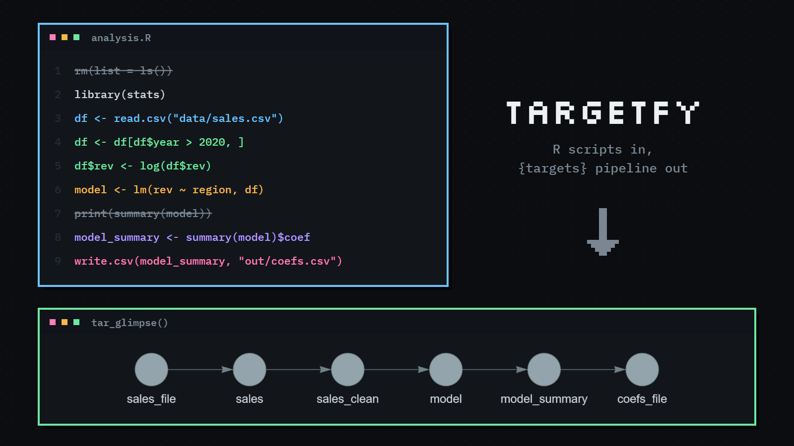
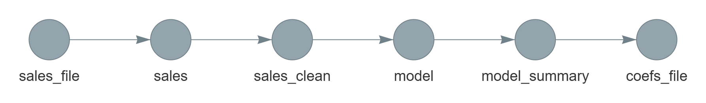

I like [{targets}](https://books.ropensci.org/targets/). It made the top 4 of my [2026 package list](../2026-11-20-top10-packages-2026/). But most of my R code doesn't start as a pipeline. It starts as a script, `analysis.R`, that I run top to bottom, and it grows. By the time I'd like caching, the work to rewrite it is enough to keep putting it off.

So I wrote [**targetfy**](https://github.com/Athospd/targetfy), a skill for [Claude Code](https://claude.com/claude-code) that does the rewrite for me. You point it at your scripts and it writes the equivalent {targets} pipeline. This is the first post about it, so here's what it does and how to try it.

## Why {targets}?

If you haven't used it: {targets} turns your analysis into a graph of steps, the *targets*, and remembers each step's result. When you change something, `tar_make()` reruns only the steps that depend on the change and skips the rest. A model that takes an hour doesn't refit because you changed a plot's title.

## A small example

Here's a typical script:

```r
rm(list = ls())
setwd("C:/my/project")
library(stats)
df <- read.csv("data/sales.csv")
df <- df[df$year > 2020, ]
df$rev <- log(df$rev)
model <- lm(rev ~ region, df)
print(summary(model))
model_summary <- summary(model)$coefficients
dir.create("out", showWarnings = FALSE)
write.csv(model_summary, "out/coefs.csv")
```

Ask Claude Code to "targetify `analysis.R`", or type `/targetfy`, and you get a `_targets.R`:

```r
library(targets)
library(tarchetypes)
tar_source("R")
tar_option_set(packages = c("stats"))
list(
  tar_file_read(sales, "data/sales.csv", read = read.csv(!!.x)),
  tar_target(sales_clean, clean_sales(sales)),
  tar_target(model, fit_model(sales_clean)),
  tar_target(model_summary, summarise_model(model)),
  tar_file(coefs_file, write_coefs(model_summary, "out/coefs.csv"))
)
```

and the functions behind it, in `R/analysis_functions.R`:

```r
clean_sales <- function(sales) {
  sales <- sales[sales$year > 2020, ]
  sales$rev <- log(sales$rev)
  sales
}

fit_model <- function(sales_clean) lm(rev ~ region, sales_clean)

summarise_model <- function(model) summary(model)$coefficients

write_coefs <- function(model_summary, path) {
  dir.create(dirname(path), showWarnings = FALSE)
  write.csv(model_summary, path)
  path
}
```

A few things happened along the way:

- The three lines that build and clean `df` became one step, `sales_clean`. A step is a meaningful object (a dataset, a model, a summary, a file), not every assignment.
- Steps got names that say what they hold (`sales_clean`, not `df`), and their functions got verbs (`clean_sales()`).
- The input CSV is tracked, so editing `data/sales.csv` reruns everything downstream. The output CSV is tracked as a file too.
- `rm(list = ls())`, `setwd()` and `print()` were dropped: they don't belong in a pipeline. Each dropped line is listed, with the reason, in a report.

## It checks its own work

This is the part I care most about. A rewrite that *looks* right isn't enough, so targetfy doesn't decide on its own that the pipeline is correct. A bundled R script runs your original scripts and the new pipeline, each in a throwaway copy of the project, and compares the results: the final objects and the files written. The conversion is accepted only when they match. If they don't, Claude reads what differs, fixes the pipeline and tries again.

It also never touches your files. Your scripts, data and `renv.lock` stay as they are; targetfy only adds the pipeline, the functions, and the report next to them. If you already have a `_targets.R`, it writes `targets_analysis.R` with its own store instead, so your existing pipeline's cache is safe. And it installs nothing: if a package is missing, it tells you.

At the end, it runs `tar_glimpse()` and shows you the pipeline's graph. This is the real one for the example above:



## Then, optionally, make it faster

Once the pipeline passes the check, targetfy offers improvements one at a time, each tied to a specific step. You can say no to all of them:

- **Storage formats**, such as `qs2` or parquet, for big objects.
- **Dynamic branching**, when a step loops over groups, files or parameters, so each branch caches on its own.
- **Parallel workers** with {crew}, when steps can run at the same time.

Each one is checked again. If an improvement changes the results, it's undone.

## Try it

You need [Claude Code](https://claude.com/claude-code) and R with `targets`, `tarchetypes`, `callr` and `jsonlite`. Install the skill with:

```sh
git clone https://github.com/Athospd/targetfy.git ~/.claude/skills/targetfy
```

Then open your project in Claude Code and ask it to convert your script, or a sequence of scripts in run order (`01_load.R`, `02_model.R`, ...). When one script saves an `.rds` that the next one reads, that becomes a direct link between steps.

For now it supports plain `.R` files. R Markdown and Quarto documents are planned.

It's new, so I'd love to hear how it does on your scripts. Issues and ideas are welcome on [GitHub](https://github.com/Athospd/targetfy).
