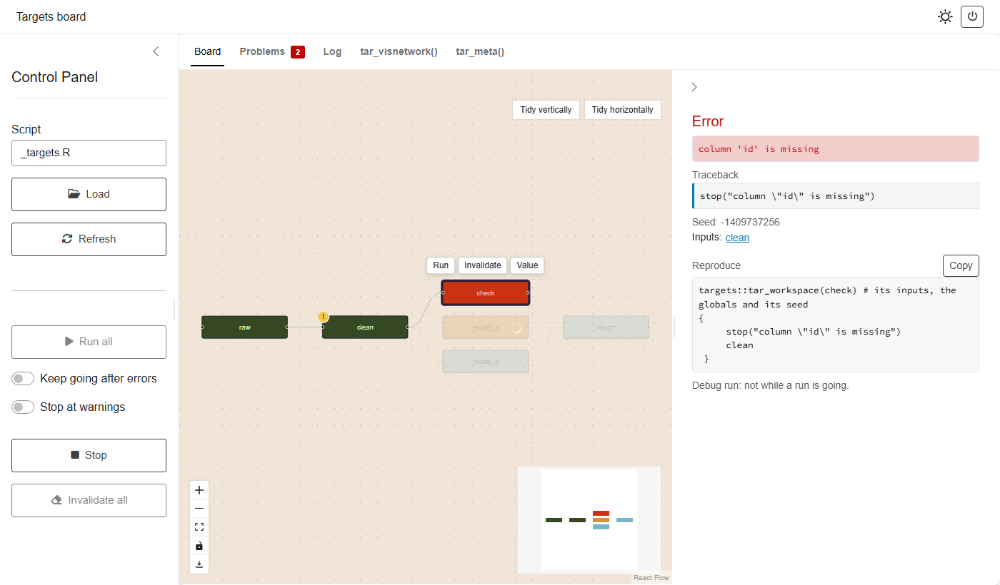

---
title: "targetsboard 0.1.0: a live view of your {targets} pipeline"
description: "An introductory look at targetsboard 0.1.0: follow pipeline runs, inspect target status and values, and debug problems while keeping your targets workflow in R."
date: 2026-11-22
author: "Athos Damiani"
categories: [r, targets, reproducibility, mlops, packages]
image: thumbnail.svg
---

A {targets} pipeline makes an analysis easier to reproduce: each target is a named step, dependencies form a graph, and cached results let `tar_make()` focus work where it is needed. But when a pipeline is running, it can still be useful to see its state, understand what changed, and trace a warning or error back to the code that produced it.

That is the problem I wanted to explore with [**targetsboard**](https://github.com/Athospd/targetsboard), a graphical companion for authors of [{targets}](https://docs.ropensci.org/targets/) pipelines. I have released its first version, **v0.1.0**. This post is a short introduction for researchers, data scientists and data engineers who already use `targets` or are curious about making analytical workflows easier to inspect and operate.

The package is still experimental and at an early stage. The board is intended to help you understand a pipeline while working on it; it does not replace the pipeline script, the store, version control, or the decisions that make an analysis reproducible.

## What the board shows

`targetsboard` draws the pipeline as a directed graph. Nodes show whether targets are up to date, outdated, running or in error. Focus a target to see its place in the dependency graph and preview its value. The board also surfaces warnings and errors, with supporting information such as a traceback and code you can use to reproduce or debug a target.



This view connects a few familiar reproducibility and MLOps concerns to the work of an R analysis: **lineage** is visible in the dependency graph, **run status** is visible as work progresses, and **debugging context** is attached to the target that needs attention. The graph is a way to inspect the pipeline, not a substitute for recording code, data inputs and environment details in your project.

## Try it with an existing project

Install the released package from GitHub:

```r
remotes::install_github("Athospd/targetsboard@v0.1.0")
```

Open an R session in a project that already has a `{targets}` pipeline, then start the board:

```r
library(targetsboard)

app <- tar_board()
```

`tar_board()` starts the board in a background R process and opens it in your browser. It uses the targets script and store configured for the current project, just as `tar_watch()` does. You can then run the pipeline from R as usual:

```r
targets::tar_make()
```

As targets run, watch their statuses update on the graph. Select a node to inspect its dependencies and value. If something warns or errors, open its problem details to review the message and traceback, then use the provided code to reproduce the target or start a debug run.

You can also start a run from the board. **Run all** builds the pipeline; target menus and selection let you run or invalidate a target, or work with a group. The **Problems** and **Log** tabs collect issues and output from the latest board run. The board's run controls include options to continue after errors or treat warnings as errors, which can help reveal multiple issues or stop at a warning with a debugging workspace.

When you are finished, close the board with its power button or stop its background process from R:

```r
app$kill()
```

The pipeline remains defined by your `targets` project. `targetsboard` does not silently rewrite `_targets.R`; the controls start runs or invalidation through `targets` and help you inspect what happened. This keeps the project script as the place to review how the analysis is built.

## See it in action

The short demo follows a pipeline run, changes the graph layout, previews target values, and finds, fixes and rebuilds after an error:

[](https://www.youtube.com/watch?v=pEsTN9rke2U)

## First release, early project

Version 0.1.0 turns an earlier prototype into a board for following and operating a pipeline during development. It includes graph and status views, target and group actions, problem and run logs, value previews, and debugging support. It also remembers graph layout and includes example pipelines for trying different situations.

This is the first release, not a claim that every workflow or large pipeline is covered. The repository describes the package as experimental and notes that performance and usability still need work. If you try it, please share issues and ideas on [GitHub](https://github.com/Athospd/targetsboard). The code and installation instructions are in the [targetsboard repository](https://github.com/Athospd/targetsboard).
